# Buba

Buba turns the folders of your vault into a visual asset library. Every file shows up as a preview in a grid: images, videos, GIFs, PDFs, Photoshop and Illustrator files, notes. Mark files with tags, a rating and comments, find them again in a click, look at them full screen and drag them onto a canvas. Your files stay where they are, as plain files in plain folders.

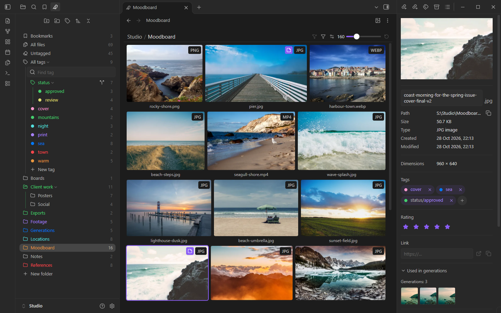

## Browse your folders

- **A grid of previews for any folder**: one folder, a folder with its subfolders, every file with a tag, your bookmarks, or all files at once. Go back and forward through visited folders like in a browser.
- **Tabs, as in Obsidian's file explorer**: the middle mouse button or "Open in new tab" opens a folder, tag or file in a new tab, and each Buba tab is titled by what it shows.
- **Three layouts**: Grid with even tiles, Justified rows and Columns, with a tile size slider and file names on or off.
- **Sorting by two keys**, for example by rating and then by date, or by type to keep files of one kind together, and a file type filter.
- **Each folder can keep its own view**, or all folders share one.
- **Previews for many formats**: PNG, JPG, GIF, WebP and other images, videos, the first page of a PDF, the full picture of PSD and PSB files, the embedded preview of AI files, the beginning of Markdown and text notes. Other files get a format badge.

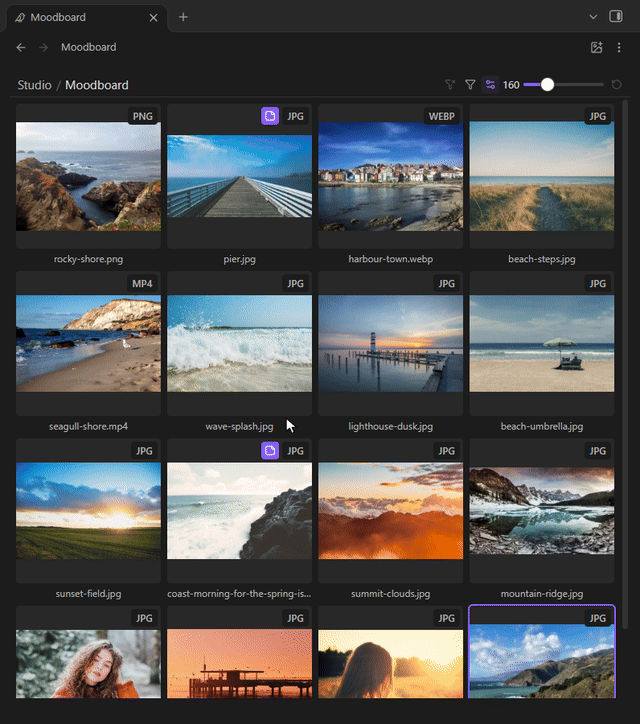

## Folders with covers

- **Folder tiles look like folders**: a glass front with the folder's cover standing inside, and more of its files fanning out when you point at the folder on a computer.
- **Give a folder a cover** to turn it into a board of references: right-click the tile and upload a picture, or make any picture in the folder its cover. Move and zoom the cover to frame it. Covers are stored in Buba's own data, never among your files, and follow the folder when you rename or move it.
- **Without a cover** a folder shows its own icon and color, as in the tree. Turn on "Cover from contents" in Buba's settings to show its newest picture instead.
- **Choose the look** in Buba's settings: one picture as the cover, a few files inside or none, the cover in front or behind the glass, and how a selected folder is marked.

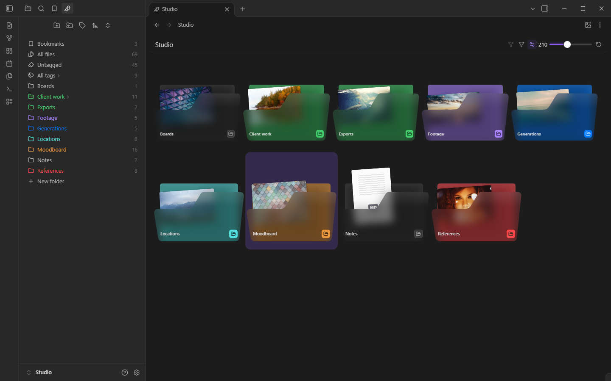

## Organize the tree

- **Folder colours and icons** in the Buba tree, so the folders you use most stand out. A closed folder shows a closed folder icon, an open one an open icon. Click the icon to open or close a folder, or double-click its name; on a computer folders open with a short slide.
- **Buttons at the top of the tree**: a new folder alongside the open one, a new subfolder, a new tag, the sort order (by name, or by created or modified time) and collapse all.
- **Bookmarks**: the "Bookmarks" row opens Obsidian's bookmarks as a grid, folders first, so the files you keep coming back to are one click away.
- **Pick several folders or tags** with Ctrl and Shift to give them one colour or icon, move them or delete them in one go.
- **Drag a folder onto another folder** to move it inside; the folder under the pointer lights up. Drop it on "All files" to move it to the top level. The open folder stays open at its new place, and Ctrl+Z in the grid moves it back.
- **Rename and delete folders** right in the tree, from the menu or with the Delete key. Delete asks first, and warns when files inside are references of generations. Tags and tag groups are deleted the same way.
- **Drag a tag onto a tag group** to move it into the group, or onto "All tags" to take it out. When the group is exclusive, Buba asks which tag each file keeps.

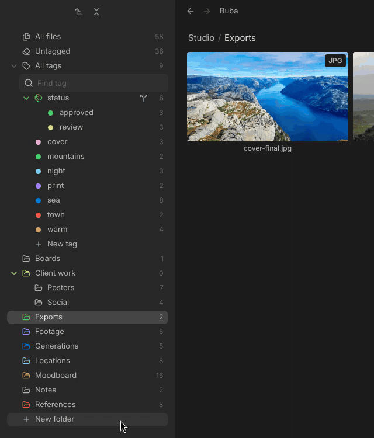

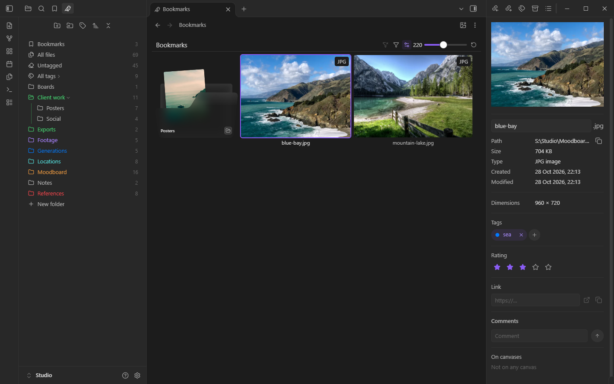

## Tags, ratings and comments

- **Tags for any file**, not only for notes, with colours and groups. A group can be exclusive, so a file has one tag of it at a time, like a status: approved or in review.
- **Click a tag** to see every file that has it, or open "Untagged" to find what you haven't sorted yet.
- **A rating from one to five stars**, and sorting by it.
- **Comments as a to-do list for the file**: mark a comment as done and it folds away under "Done", so only the open ones stay in view. Tiles with open comments show a badge.
- **The file panel** shows the preview, size, format and resolution, tags, rating, comments, a web link for the file and the canvases it is on.

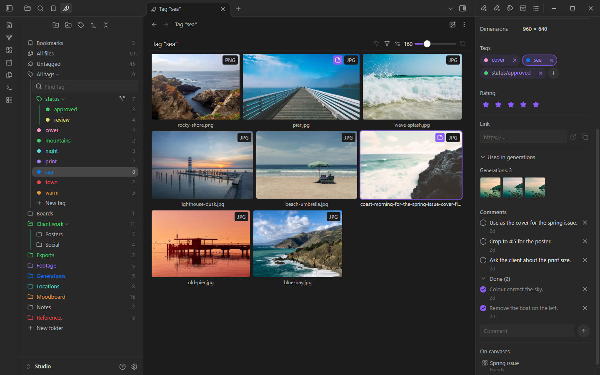

## Watch videos and look closer

- **Videos play on hover** right in the grid, on a computer, so you find the right clip without opening each one.
- **A full-screen viewer** for images and videos. Move through the folder with the arrow keys, or with a swipe on a phone.

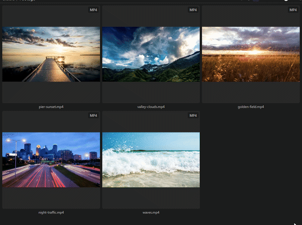

## Canvas and everyday file work

- **Drag files from the grid onto an Obsidian canvas** to add them as cards. The file panel then lists the canvases a file is on, and shows the file you select on a canvas.
- **Copy, paste and undo as in a file manager**: Ctrl+A selects every tile, Ctrl+C and Ctrl+V copy tiles into another folder, and Ctrl+Z undoes the last Buba action, whatever it was.
- **Right-click empty space** in the grid to create a folder, note, canvas or base right there, or to paste.
- **Rename, duplicate, move and delete** from the grid. Moving thousands of files shows its progress and can be stopped.
- **Drop or paste files from your computer** to add them to the open folder; they stay selected, so they never get lost in the sort order. Drag files from the grid into other apps.
- **Install fonts** on a computer: right-click a .ttf, .otf or .ttc file, or several, and choose "Install font".

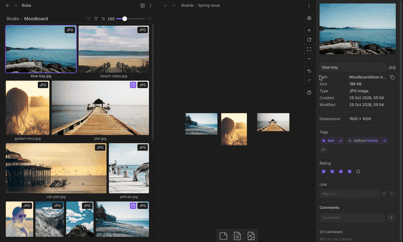

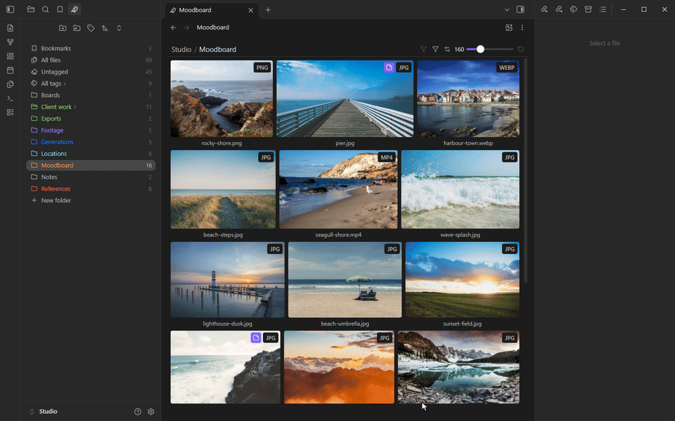

## On the phone

Buba works in the Obsidian mobile app with the same grid, tree and file panel, laid out for a small screen. Switch between the Buba tree and Obsidian's file explorer at the bottom of the side panel. Menus open with a long press, the file panel is one tap away from the menu, and the viewer moves between files with a swipe. Files opened from the grid get arrows to the next and previous file, and "Close" brings you back to the grid.

A few things need a computer: video playback on hover, dragging folders, tags and files, dropping files from the file manager, installing fonts. To add files on a phone, share them to Obsidian from another app or use the add items in the grid menu.

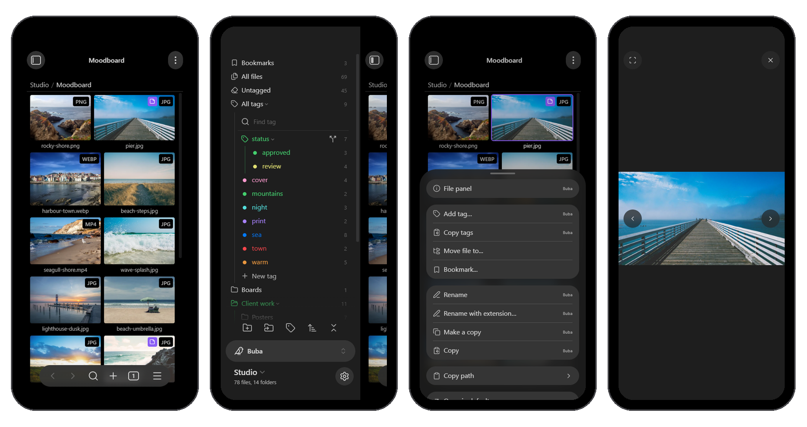

## Generation passport

For a generated image, video or sound, the file panel shows what made it: model, service, the prompt with links to its references, every parameter, the cost, when and by whom. A file used as a reference lists the files made from it. "Copy for agent" hands all of it to an agent that should repeat the generation. Passports follow files when you move or rename them, in Obsidian or in your system's file manager.

The passport is written by the agent that made the file, see below.

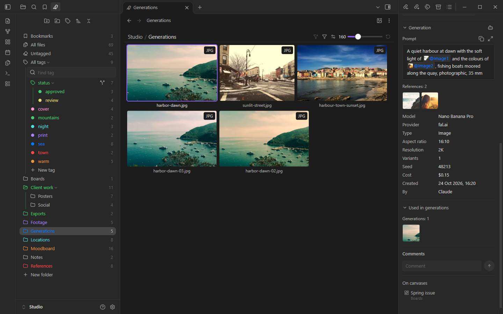

## For AI agents

If an AI agent generates files for you, let it record a passport for each one, so you see later what made it.

- **The skill.** Copy the folder [`skills/buba-obsidian`](skills/buba-obsidian) into your agent's skills folder, for example `~/.claude/skills/` for Claude Code. The agent then knows when to write a passport and how to use the other Buba commands.
- **Without the skill**, tell your agent to run `obsidian buba:passport-help`: it answers with the whole format and the steps for the Buba version you have installed.
- **Commands.** Buba adds commands to the Obsidian command line, so an agent can find files by tag, read and set tags, ratings and comments, open a folder, add file cards to a canvas and record generation passports:

  ```
  obsidian buba:find tag=hero
  obsidian buba:tag path=Moodboard/cover.jpg tag=print
  obsidian buba:rate path=Moodboard/cover.jpg rating=5
  obsidian buba:info path=Moodboard/cover.jpg
  ```

  Also `buba:comment`, `buba:open`, `buba:canvas-add`, `buba:passport`, `buba:passport-get` and `buba:passport-help`.

- The commands need desktop Obsidian running, with the command line turned on in Obsidian's settings. An agent that can't use the command line can drop a request file into `__buba-data/inbox/` instead; the help explains how.

## Install

Buba needs Obsidian 1.13.1 or newer, on a computer or a phone.

In Obsidian: **Settings → Community plugins → Browse**, search for **Buba**, install and enable it.

To install by hand: download `main.js`, `manifest.json` and `styles.css` from the [latest release](https://github.com/Opus721/obsidian-buba/releases/latest), put them into the folder `<your vault>/.obsidian/plugins/buba/` and enable Buba in **Settings → Community plugins**.

On first start Buba suggests two Obsidian options that help it work well: keep internal links updated when files move, and detect all file extensions so that PSD, AI and other files show up. You can come back to them later in the Buba settings.

## Languages

Buba follows the language of Obsidian: English by default, Russian when Obsidian is in Russian. Dates, numbers and plural forms follow the language too. More languages may come later.

## Customize the look

Buba follows your Obsidian theme, and the [Buba theme](https://github.com/Opus721/obsidian-buba-theme) is made to go with it. With the [Style Settings](https://github.com/mgmeyers/obsidian-style-settings) plugin installed, its settings get a **Buba** section: row spacing in the folder and tag trees, tag sizes, how files without a preview look, the comment badge and the "Buba" label in menus. The phone has its own sliders where it needs other numbers. Without Style Settings nothing changes.

## Where your data lives

- **Your files** are not moved, copied or converted. Buba only reads them to draw previews.
- **Tags, ratings, comments and generation passports** are saved in the folder `__buba-data` at the root of your vault, one small journal per device. The folder syncs with your vault, so marks reach your other devices through Obsidian Sync or any other sync service. Please don't delete or rename this folder: it holds the marks of all your devices. If you use Obsidian Sync, turn on **Sync all other types** in the Sync settings, otherwise the folder stays on this device.
- **Previews** are cached on each device in the app's local database, not in your vault, and are rebuilt when needed.
- **Settings** are stored in the plugin folder, like any other plugin's settings.
- **Error log.** Buba writes its own errors to a small local file, so that a problem can be looked into: on a computer in the plugin folder, on a phone or tablet in `__buba-data`. The file is never sent anywhere; it travels only with your own sync.

## Privacy

- No network requests, no telemetry, no account and no payment.
- Buba reads files from outside your vault only when you drop, paste or pick them yourself, to copy them into the vault.

## License

[MIT](LICENSE). Buba bundles two small libraries, `@tanstack/virtual-core` (MIT) and `idb` (ISC); their licences are in [THIRD_PARTY_LICENSES.md](THIRD_PARTY_LICENSES.md) and at the top of `main.js`. The photos in the screenshots are from [Unsplash](https://unsplash.com).
